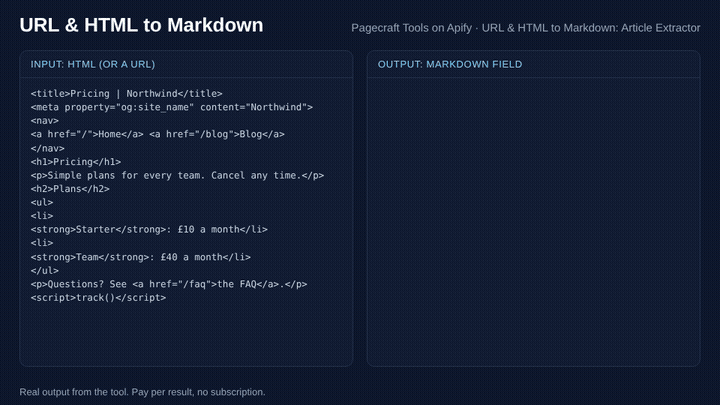

# How to convert web pages and HTML to Markdown (2026 guide)

*Written with AI assistance by Pagecraft Tools and checked on 12 November 2026. We make one of the tools below; we say where others fit better.*

Web pages are mostly menus, ads, cookie banners and scripts. For an LLM prompt, a RAG index or a notes app you want just the content, as Markdown. There are two separate jobs:

1. **Main content only** (news, blog posts): find the article and drop everything around it.
2. **Whole page** (docs, product, pricing and landing pages, emails): convert everything in the body.

## Option 1: do it in code (free)

- **Main content:** [Mozilla Readability](https://github.com/mozilla/readability) (the engine behind Firefox Reader View) picks out the article.
- **HTML to Markdown:** [Turndown](https://github.com/mixmark-io/turndown) (JavaScript) or [markdownify](https://pypi.org/project/markdownify/) (Python) convert HTML to Markdown.
- **Pages that need JavaScript:** load them in a headless browser (Playwright, Puppeteer) first, then convert.

Pros: free and fully under your control. Cons: you handle downloads, retries, blocked sites, encodings and metadata yourself.

## Option 2: hosted tools

On the [Apify Store](https://apify.com/store), searching "url to markdown" or "html to markdown" shows several tools, for example:

- **[URL to markdown](https://apify.com/apify/url-to-markdown)** (by Apify).
- **[Smart page fetcher](https://apify.com/shelvick/smart-page-fetcher)** (shelvick): fetches pages, including harder-to-reach sites, as HTML, Markdown or text.
- **[URL & HTML to Markdown: Article Extractor](https://apify.com/pagecraft/article-extractor)** (ours).



### What our tool does, and does not do

- Takes **URLs or raw HTML** (paste one document, or send a list through the API as `htmlDocuments`, with an optional base URL so relative links resolve).
- **Main article** mode uses Readability; **whole page** mode converts everything in the body, minus scripts and styles.
- Returns Markdown, plain text or clean HTML, plus title, authors, published and updated dates, site name, language, main image and word count.
- It reads pages as the server sends them, without a browser. Pages that build their content with JavaScript, or sit behind a login or paywall, come back with a plain-English reason instead of empty text. For those, a browser-based tool is the better choice.
- Price: from $3 per 1,000 pages; pages that cannot be read cost less. See the [tool page](https://apify.com/pagecraft/article-extractor) for current prices.

Example input (HTML to Markdown through the API):

```json
{
  "urls": [],
  "htmlDocuments": [{ "html": "<h1>Pricing</h1><p>Plans for <a href=\"/teams\">teams</a>.</p>", "url": "https://www.example.com/pricing" }],
  "outputFormats": ["markdown"],
  "contentMode": "page"
}
```

### From an AI agent

Through the [Apify MCP server](https://mcp.apify.com/), load only this tool with:

```
https://mcp.apify.com?tools=pagecraft/article-extractor
```

Then ask, for example, "Get these five articles as Markdown with their authors and publish dates".

## Tips

1. **Pick the mode for the page type.** Article mode for news and blogs; whole page for docs and product pages.
2. **Keep the source URL and date** next to each chunk, so answers can cite them.
3. **Respect each site's terms and copyright** when you store or reuse the text.

## Related

- [PDF to Markdown](./pdf-to-markdown.md)
- [All Pagecraft tools](../README.md)
