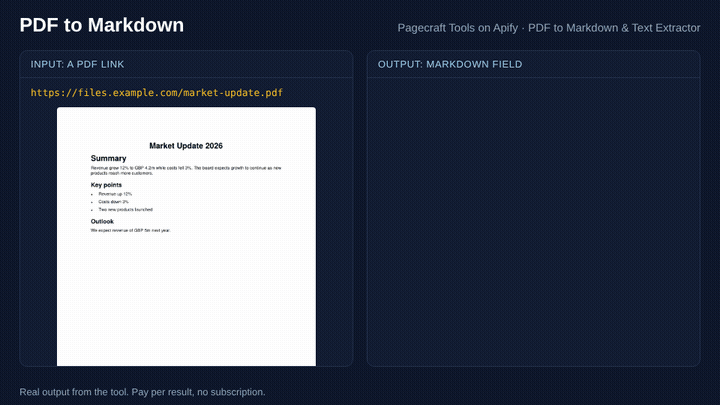

# How to convert PDFs to Markdown for LLMs and RAG (2026 guide)

*Written with AI assistance by Pagecraft Tools and checked against each project's own listing on 12 November 2026. We make one of the tools below; we say where others do a job better.*

Markdown is the easiest format to feed into an LLM, a vector database or a notes app: headings show the structure, lists stay lists, and there is no layout noise. Turning a PDF into good Markdown is harder than it looks, because a PDF stores positioned text, not structure. This guide covers the main ways to do it and when each one fits.

## The quick answer

| You have | Use |
| --- | --- |
| A few files and Python on your machine | An open-source library (MarkItDown, Docling, Marker or PyMuPDF4LLM) |
| Scanned PDFs, complex tables or maths | A tool with OCR or layout models (Docling, Marker, MinerU, or an OCR service) |
| Hundreds of PDF links, no servers, or an AI agent that needs to call it | A hosted tool that takes URLs and charges per file |

## Option 1: open-source libraries (free, run them yourself)

| Library | Licence (from PyPI, Nov 2026) | Good at |
| --- | --- | --- |
| [MarkItDown](https://pypi.org/project/markitdown/) (Microsoft) | MIT | Quick conversion of many file types (PDF, Word, PowerPoint, Excel) to Markdown |
| [Docling](https://pypi.org/project/docling/) | MIT | Layout-aware parsing of PDF, DOCX, HTML and more, with tables |
| [Marker](https://pypi.org/project/marker-pdf/) | Apache-2.0 (check the model weights' own terms for commercial use) | High-quality conversion including tables and equations |
| [PyMuPDF4LLM](https://pypi.org/project/pymupdf4llm/) | Built on PyMuPDF, which is dual licensed AGPL-3.0 or commercial | Fast Markdown from digital PDFs |
| [MinerU](https://pypi.org/project/mineru/) | Its own MinerU open-source licence (read it before commercial use) | Complex layouts and scanned documents |

Pros: free, private, and the layout-model tools handle tables and scans well. Cons: you install and run them, the model-based ones are heavy (a GPU helps), and you still need code to download files, retry failures and run on a schedule.

## Option 2: hosted tools that take PDF links

If your PDFs live at URLs (reports, papers, filings, tenders), a hosted tool saves the download and server work. On the [Apify Store](https://apify.com/store), searching "pdf to markdown" shows several, priced per file or per page. A few, with their own descriptions:

- **[PDF Text Extractor](https://apify.com/gochujang/pdf-text-extractor)** (gochujang): text and Markdown, with OCR for scanned PDFs. The most used in this search.
- **[PDF to Markdown & JSON Converter (Docling)](https://apify.com/actorzlab/docling-pdf-converter)** (actorzlab): Docling in the cloud, with tables and OCR, priced per page.
- **[PDF to Markdown & Text Extractor](https://apify.com/pagecraft/pdf-text-extractor)** (ours): Markdown and plain text from digital PDFs, with text per page and metadata (title, author, dates, page count), priced per PDF.



### What our tool does, and does not do

- Headings come from font size (bigger text becomes `#`, `##`, `###`), bullets and numbered lines become lists, and lines that wrap are joined back into paragraphs.
- It reads the PDF's text layer with Mozilla pdf.js. Scanned PDFs have no text layer: the tool flags them (`hasTextLayer: false`) and you need OCR (for example our [OCR Image to Text](https://apify.com/pagecraft/ocr-image-to-text) for images, or one of the OCR-capable tools above).
- Tables keep their text but not their grid. If tables matter, use Docling or Marker.
- Price: from $4 per 1,000 PDFs up to 2 MB, with a small fee per extra MB for big files. No per-page fee. See the [tool page](https://apify.com/pagecraft/pdf-text-extractor) for current prices.

Example input:

```json
{ "urls": ["https://www.example.com/annual-report.pdf"], "markdown": true, "includePages": true }
```

### From an AI agent

Hosted tools on Apify can be called by AI agents through the [Apify MCP server](https://mcp.apify.com/). To load only this tool:

```
https://mcp.apify.com?tools=pagecraft/pdf-text-extractor
```

Then ask your agent something like "Convert these three annual report PDFs to Markdown, page by page".

## Tips for better Markdown from PDFs

1. **Check for a text layer first.** If selecting text in a PDF viewer does not work, the file is a scan and needs OCR.
2. **Keep page numbers.** For RAG, store the text per page so answers can cite the page.
3. **Chunk by heading, not by character count.** Markdown headings give natural chunk boundaries.
4. **Spot-check tables.** Most converters struggle with tables that span pages or have merged cells.

## Related

- [URL and HTML to Markdown](./html-to-markdown.md): the same for web pages.
- [All Pagecraft tools](../README.md)
